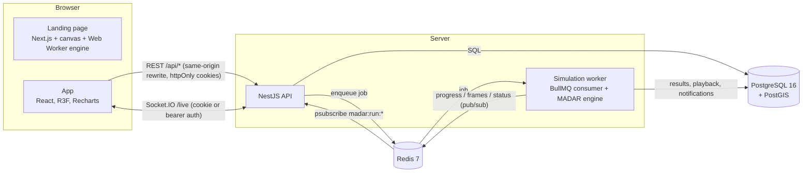

# Architecture



## Components

**`@madar/sim-engine`** — a pure TypeScript library with no I/O. It contains the road graph, path finding, the traffic model, signal logic, demand model, building-energy model, comparison logic and a binary playback codec. Because it is pure and deterministic it runs unchanged in three places: the worker (authoritative runs), the API (validation, Webster proposals, energy endpoint) and the browser (the landing page's live simulation).

**`apps/api`** (NestJS 11) — modules for auth, users, cities, projects, scenarios, runs, reports, notifications, audit and the WebSocket gateway. Request bodies are validated with the same Zod schemas the web client uses for instant feedback (`@madar/shared`); the server never trusts the client copy. OpenAPI is generated from those schemas at `/api/docs`.

**`workers/simulation`** — a BullMQ worker. It claims a queued run atomically (`UPDATE … WHERE status = 'queued'`), rebuilds the city network *from the database*, executes the engine in 20-second simulated chunks and between chunks: checks the Redis control key (pause/resume/cancel), publishes progress and a throttled vehicle frame, optionally sleeps to keep a live viewing pace. On completion it persists every result in one transaction and writes a notification.

**`packages/db`** — Drizzle schema and SQL migrations, city seeding, the network loader and result persistence. Spatial columns are PostGIS geometries with GiST indexes.

**`apps/web`** (Next.js 15, App Router) — the cinematic landing page and the application. REST calls are proxied same-origin (`/api/*` → API) so authentication cookies stay first-party.

## Run lifecycle

```
queued ──claim──▶ running ──▶ completed
  │                 │  ▲
  │ cancel          │  │ resume
  ▼                 ▼  │
cancelled ◀──── paused ┘          running ──error──▶ failed
```

The API stores an immutable `params_snapshot` and an `input_fingerprint` for every run. Later edits to the scenario never change history, and identical inputs are detected (the client is told the result will be identical).

## Real-time design

Two classes of message travel over the socket:

| Class | Messages | Delivery |
|---|---|---|
| High-frequency, replaceable | `run:frame` — packed `Uint32` vehicle positions (≤ 1,000 vehicles) + per-link congestion `Uint16` | Socket.IO **volatile** emit (dropped for slow clients rather than buffered), throttled by the worker to ~6 per second |
| Low-frequency, reliable | `run:progress`, `run:sample` (one per simulated minute), `run:event`, `run:status`, `notification` | normal emit |

Persisted metrics are separate from frames: the worker stores a minute-by-minute time series in SQL and the full playback as a gzip-compressed binary blob. The client reconnects automatically, re-subscribes on `connect`, and reconciles with the REST API every few seconds so it is correct even if messages were missed.

## Security

- Passwords: **argon2id** (19 MiB, t=2). Login timing is equalised for unknown accounts; five failed attempts lock an account for 15 minutes.
- Sessions: 15-minute HS256 access JWT (issuer/audience pinned) + opaque 256-bit refresh token stored only as SHA-256. Refresh tokens **rotate** on every use; presenting a rotated token revokes all of that user's sessions (reuse detection). Logout and password change revoke sessions server-side.
- Cookies: `httpOnly`, `SameSite=Lax`, `Secure` in production (enforced at boot); the refresh cookie is scoped to `/api/auth`.
- CSRF: cookie-authenticated state-changing requests must carry `X-Requested-With: madar`, which cross-site forms cannot set and cross-origin scripts cannot send past the CORS allow-list.
- Authorisation: global role permissions (`admin`, `planner`, `viewer`) from `@madar/shared/permissions.ts` (also seeded into the `roles` table) **and** per-project membership (`owner`, `editor`, `viewer`) checked in one place, `ProjectAccessService`. Inaccessible resources return 404, not 403, so IDs are not confirmed.
- WebSockets: the handshake verifies the same access token and session; joining `run:<id>` repeats the project access check.
- Rate limiting (`@nestjs/throttler`), Helmet headers, CORS allow-list, validated environment (the process refuses to start with weak or missing secrets), safe error filter (no stack traces or SQL leak to clients), structured logs with cookies/authorization redacted, audit log for every mutation.
