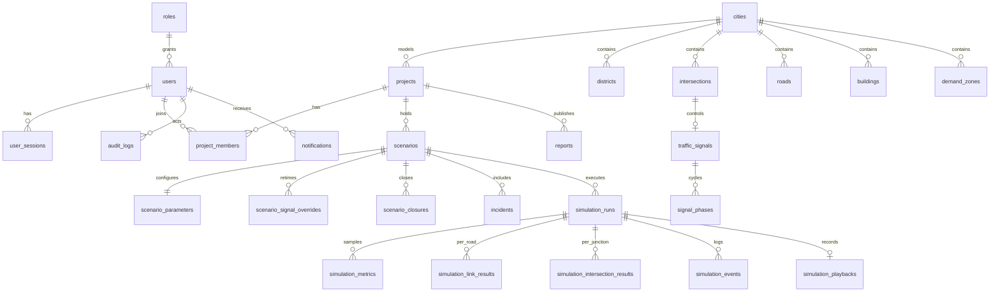

# Database

PostgreSQL 16 with PostGIS 3. Schema source: `packages/db/src/schema.ts` (Drizzle); SQL migrations in `packages/db/migrations`. Spatial columns use **SRID 0** — Madar lives in a local planar frame in metres and is deliberately not georeferenced to any real place.



## Design notes

- **Typed columns over JSON.** Every metric that is filtered, sorted or compared (travel time, delay, throughput, queues, energy estimates) is a typed column on `simulation_runs`. JSON is used only where structure is open-ended: `params_snapshot` (the exact, immutable engine input of a run), `energy_assumptions`, `audit_logs.metadata` and the frozen `reports.content`.
- **Surrogate keys + stable codes.** Network elements have UUID primary keys and a `(city_id, code)` unique index. The engine works with codes (`c3r2>c3r3`); the loader returns both maps.
- **Constraints in the database.** Positive lengths and speeds, lanes 1–8, no self-loop roads, signal green 5–120 s / yellow 3–6 s / all-red 0–5 s, incident severity in (0, 1], closure windows, scenario parameter ranges, progress 0–1, case-insensitive unique emails, e-mail shape.
- **Indexes.** GiST on every geometry; composite indexes for the hot paths (`simulation_runs(project_id, status)`, `(scenario_id, queued_at)`, `input_fingerprint`, `audit_logs(actor_id, created_at)`, `simulation_events(run_id, t_s)`); composite primary keys for per-run result tables.
- **Playback** is stored as gzip of a compact binary codec (12 bytes per vehicle per frame) — about 3 MB for an hour at 4-second frames — and served with `Content-Encoding: gzip` so browsers inflate it natively.
- **Deletes cascade** from projects and scenarios to their runs and results; network rows are referenced, not cascaded, from results.

## Spatial queries used

```sql
-- buildings within 300 m of a point, nearest first (ST_DWithin + KNN on GiST)
select code, name, ST_Distance(footprint, p) from buildings
where city_id = $1 and ST_DWithin(footprint, p, 300) order by footprint <-> p limit 25;

-- reverse-geocode: nearest road and containing district
select code from roads where city_id = $1 order by geom <-> p limit 1;
select code from districts where city_id = $1 and ST_Contains(boundary, p);
```

## Migrations & seed

```bash
pnpm db:migrate   # applies SQL migrations (creates the postgis extension first)
pnpm db:seed      # city (idempotent per version), roles from the RBAC policy, demo users, sample project
```

Regenerate after a schema change: `pnpm --filter @madar/db generate`.
